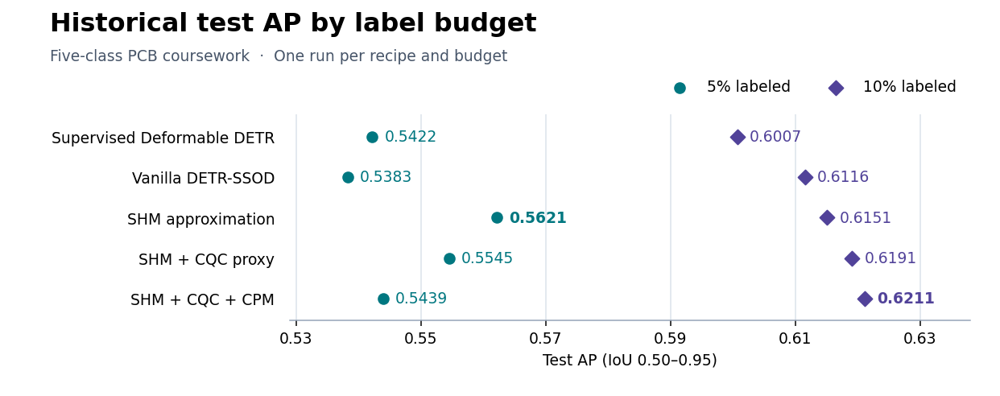

# Semi-Supervised Deformable DETR and a Multi-Source PCB Benchmark

[](https://github.com/ChungKein4320/pcb-defect-detection-benchmark/actions/workflows/repository-checks.yml)

This repository studies PCB defect localization in two settings. A university team project tests whether unlabeled images help Deformable DETR when few images have annotations. A separate public benchmark compares five detectors on a merged dataset from three sources.

## Semi-Supervised Deformable DETR Research

The supervised baseline fine-tunes Deformable DETR on 5% or 10% of the training images. In the semi-supervised recipes, an exponential moving average (EMA) of the student acts as a teacher. It predicts boxes on unlabeled images, and the student learns from those pseudo-labels alongside ground-truth boxes.

The recipes adapt three ideas from Semi-DETR. **SHM** duplicates pseudo-targets within the existing one-to-one matcher. **CQC** matches predictions and penalizes class and box disagreement as a proxy for the paper's decoder-level consistency. **CPM** uses assignment costs and a Gaussian mixture with a quantile fallback to filter the boxes used for consistency. [Semi-DETR (CVPR 2023)](https://arxiv.org/abs/2307.08095)



The chart replots saved test scores on the five-class coursework split (2,518 train, 840 validation, 838 test). SHM led at 5% labeling, where vanilla SSOD trailed the supervised baseline. SHM + CQC + CPM led at 10%. Each recipe used one seed. Changes in pseudo-label generation and sampling limit attribution to individual components, and a filename audit flagged possible train/test image-family overlap.

[Results and visual analysis](notebooks/semi_supervised_research/06_historical_results_and_analysis.ipynb) · [Training implementations](docs/semi_supervised_research.md#read-the-implementation) · [Evidence provenance and limitations](docs/semi_supervised_research.md#evidence-and-interpretation) · [Reproduction and local verification](docs/reproducibility.md)

## Public Six-Class Detection Benchmark

The benchmark standardizes DeepPCB, DsPCBSD+, and HRIPCB into one taxonomy. The merged dataset contains 9,448 images (6,624 train, 937 validation, 1,887 test). The detector comparison covers one-stage, two-stage, and transformer models plus two custom recipes.

| Detector | Merged-test mAP50–95 |
| --- | ---: |
| YOLOv11s | 0.5761 |
| RT-DETR-L | **0.6595** |
| Faster R-CNN ResNet50-FPN | 0.5918 |
| YOLOv11s + CBAMLite + BiFPNLite + P2 | 0.5764 |
| RT-DETR-L HybridOpt | 0.6112 |

RT-DETR-L led the merged test and all three source subsets. Those subsets come from sources represented in training. The custom YOLO recipe moved merged AP by just 0.0003, and HybridOpt scored below stock RT-DETR-L. Spur had the lowest average AP across the five detectors.

See the [benchmark guide and notebooks](docs/public_benchmark.md), [merged results](reports/public_benchmark/tables/model_comparison_merged_test.csv), [source breakdown](reports/public_benchmark/tables/model_comparison_sourcewise_pivot.csv), and [evaluation protocol](docs/benchmark_protocol.md). The protocol explains the evaluator and timing differences.

## Inspect and reproduce

```sh
python -m pip install Pillow
python -m unittest discover -s tests -v
python scripts/validate_reproducibility.py
python scripts/check_semidetr_public_safety.py
```

These checks use committed artifacts and need no GPU or dataset. See the [reproducibility guide](docs/reproducibility.md) for dataset audits, an offline benchmark notebook, and the requirements for training or verifying the original coursework evidence.
