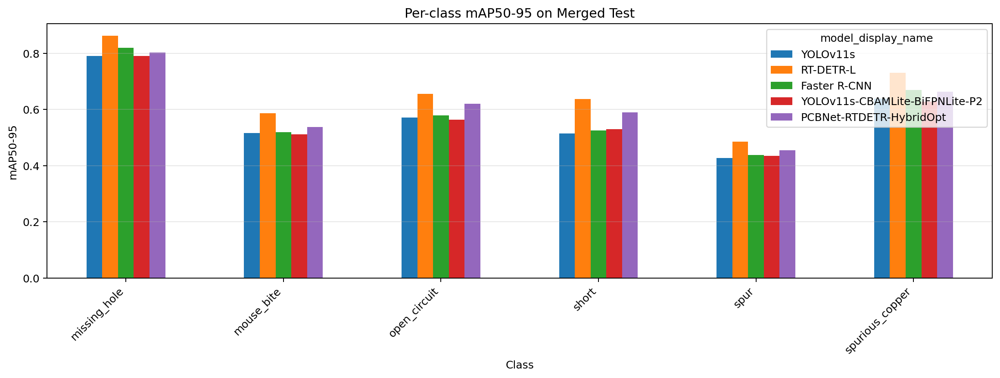

# Public Six-Class Detection Benchmark

## Dataset and provenance

The benchmark uses three YOLO-format v1 exports. The upstream sources document their collection and labels. The exports supplied the split assignments and images for the historical runs.

| Source | Upstream | Historical export | Train / validation / test after preparation |
| --- | --- | --- | ---: |
| DeepPCB | [Author repository](https://github.com/tangsanli5201/DeepPCB) | [YOLO export](https://universe.roboflow.com/hi-paju4/deeppcb-4dhir-sj6m5/dataset/1) | 1,050 / 150 / 300 |
| DsPCBSD+ | [Author dataset](https://doi.org/10.6084/m9.figshare.24970329) | [YOLO export](https://app.roboflow.com/hi-paju4/dspcbsd-ozxnv-tovnu/1) | 5,089 / 718 / 1,448 |
| HRIPCB | [Source publication record](https://ir.pku.edu.cn/handle/20.500.11897/591582) | [YOLO export](https://universe.roboflow.com/hi-paju4/hripcb-cjgsq/dataset/1) | 485 / 69 / 139 |
| Merged | | | 6,624 / 937 / 1,887 |

The export metadata lists CC BY 4.0 for all three exports. The DsPCBSD+ upstream deposit also lists CC BY 4.0. The export links identify the local metadata records, and availability can depend on account access. Verify the applicable terms and attribution for the exact copy before redistribution. The repository contains preparation code and aggregate results. The images, labels, and packaged derivatives stay outside the active tree.

[Preparation notebook](../notebooks/public_benchmark/01_prepare_dataset.ipynb) maps the YOLO labels to `0 missing_hole`, `1 mouse_bite`, `2 open_circuit`, `3 short`, `4 spur`, and `5 spurious_copper`. For DsPCBSD+ it drops boxes from the three unmapped categories (`CS`, `CFO`, `BMFO`) and drops images with no valid remaining boxes. It prefixes names by source and merges by split, without hard balancing. See the [audit](dataset_integrity.md) for exact-duplicate and labeling checks and their scope.

## Detector configurations

| Notebook | Role |
| --- | --- |
| [YOLOv11s](../notebooks/public_benchmark/02_train_yolo11s.ipynb) | Compact one-stage baseline |
| [RT-DETR-L](../notebooks/public_benchmark/03_train_rtdetr_l.ipynb) | Transformer detector and reference for HybridOpt |
| [Faster R-CNN ResNet50-FPN](../notebooks/public_benchmark/04_train_faster_rcnn.ipynb) | Two-stage detector with an FPN backbone |
| [Custom YOLOv11s](../notebooks/public_benchmark/05_train_custom_yolo11s.ipynb) | Tests lightweight attention, feature fusion and a high-resolution P2 head for small defects |
| [RT-DETR-L HybridOpt](../notebooks/public_benchmark/06_train_rtdetr_hybridopt.ipynb) | Uses the stock RT-DETR-L architecture with a different training recipe, including 768 px inputs and AdamW with cosine scheduling |

The training code and configuration cells preserve the historical Kaggle recipes. The archive section in each notebook pairs a verified evaluation summary with the original loss and validation figure. Raw logs and prediction grids stay outside these sections. The [experiment manifest](../configs/experiments/public_benchmark.json) maps each recipe to the corresponding source-wise evaluation CSV.

## Results and error analysis

The [merged table](../reports/public_benchmark/tables/model_comparison_merged_test.csv) records the overall accuracy metrics. The [source table](../reports/public_benchmark/tables/model_comparison_sourcewise_pivot.csv) shows a sizeable drop from DeepPCB to DsPCBSD+ and HRIPCB for RT-DETR-L, even though it leads each subset. This measures performance on held-out images from each training source. Class distributions, source difficulty, and sample sizes differ between subsets.

In the [per-class comparison](../reports/public_benchmark/tables/class_difficulty_summary_merged_test.csv), spur has the lowest average AP (0.4476), followed by mouse bite (0.5342). The custom YOLO model improves spur slightly (0.4353 vs 0.4265) while mouse bite and spurious copper decline. This explains why a small-object architectural change merits a per-class comparison even when merged AP barely moves. These are aggregate error indicators. They cannot identify individual false positives or distinguish classification errors from localization errors.

The [comparison notebook](../notebooks/public_benchmark/07_compare_results.ipynb) regenerates tables and charts on CPU from the model CSVs. Read the [evaluation and timing protocol](benchmark_protocol.md) before interpreting cross-backend differences.
